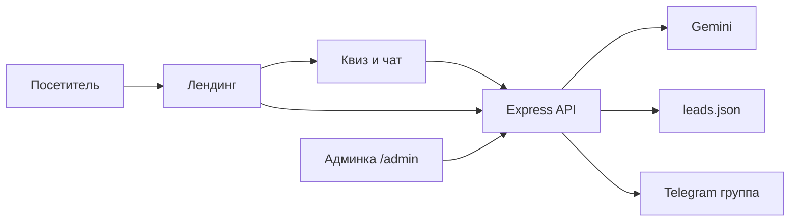

# Лендинг веб-студии с ИИ-заявками

## Продукт и тексты

Бренд: **Luma** — веб-студия, которая делает сайты и лендинги со встроенным ИИ для сбора заявок.

Оффер на первом экране: сайт, который сам разговаривает с клиентом и приводит его к заявке, а не просто «красивая картинка».

Секции лендинга (все на русском):

- Hero: оффер, короткий подзаголовок, CTA «Рассчитать проект» и «Поговорить с ИИ»
- Преимущества: ИИ-квалификация лидов, скорость запуска, заявки в админку и Telegram, дизайн под конверсию
- Отзывы: 3–4 карточки клиентов студии
- FAQ: 5–6 вопросов (сроки, цена, как работает ИИ, Telegram)
- Форма заявки: имя, телефон/Telegram, тип сайта, комментарий

Переключатель светлой/тёмной темы **не добавляем**. Одна тема: тёмный холст + нежный анимированный неон (циан → фиолет → маджента → мята).

## Стек (JavaScript)

Один Node.js-проект, без React:

- [Express](https://expressjs.com/) — статика + API
- HTML/CSS/JS в `public/`
- [GSAP](https://gsap.com/) + ScrollTrigger — параллакс hero, плавное появление секций
- [Lenis](https://github.com/darkroomengineering/lenis) — плавный скролл
- Gemini REST: модель `gemini-3.5-flash-lite`
- Telegram Bot API (`sendMessage`) — без лишних SDK
- Заявки в `data/leads.json` (файл создаётся при старте)

Запуск: `npm install` → `.env` → `npm start` → `http://localhost:3000`

## Дизайн

- Фон `#07060f`, стекло-панели, тонкое неоновое свечение по краям
- CSS `@keyframes` на `background-position` / `filter` у градиентных орбов (не агрессивный flicker)
- Шрифты: **Syne** (заголовки) + **Manrope** (текст)
- `prefers-reduced-motion`: без параллакса и бесконечной анимации неона

## ИИ-помощник

Плавающая кнопка → панель:

1. Короткий квиз (тип сайта, цель, бюджет, срок)
2. Чат с Gemini: системный промпт про услуги Luma, цены-ориентиры, тон «мягко подвести к заявке»
3. Когда клиент готов — форма контактов внутри виджета; ответы квиза уходят вместе с заявкой

API:

- `POST /api/chat` — прокси на Gemini (ключ только на сервере)
- `POST /api/leads` — сохранить + отправить в Telegram
- `GET /api/leads` + `PATCH /api/leads/:id` — только после входа в админку

## Заявки: админка и Telegram

**Telegram:** бот пишет в **группу** (удобнее канала: несколько менеджеров сразу видят заявку, проще настройка `CHAT_ID`).

Нужны в `.env`: `GEMINI_API_KEY`, `TELEGRAM_BOT_TOKEN`, `TELEGRAM_CHAT_ID`, `ADMIN_PASSWORD`.

Поток:

**Админка** `/admin`: простой пароль из `.env`, таблица заявок (дата, имя, контакт, источник: форма / квиз / чат, ответы квиза, статус), кнопка «в работе / закрыта». Без публичной регистрации.

## Файлы

- `[package.json](package.json)`, `[.env.example](.env.example)`, `[README.md](README.md)` — ключи и как получить chat id группы
- `[server/index.js](server/index.js)` — Express, чат, заявки, сессия админа, Telegram
- `[public/index.html](public/index.html)`, `[public/css/style.css](public/css/style.css)`, `[public/js/main.js](public/js/main.js)` — лендинг, квиз, анимации
- `[public/admin.html](public/admin.html)` + JS админки

После сборки открою лендинг и `/admin` в браузере и пройду форму, квиз и появление секций при скролле.